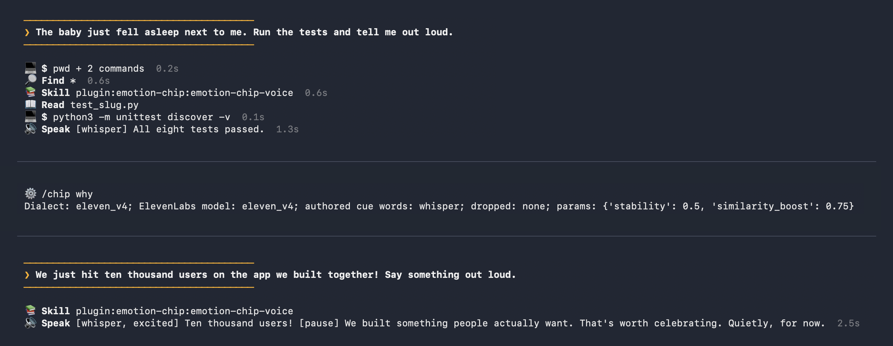

# AI Emotion Chip: Hermes Emotion Chip


**The agent decides how to say it. Hermes Emotion Chip renders the delivery the agent chose; it measures nothing
about feelings.**

Hermes Emotion Chip is a [Hermes Agent](https://github.com/NousResearch/hermes-agent) plugin. The agent writes its
own delivery cues, a small bracket score such as `[sigh]`, `[whisper: it passed.]`, `[pause]` or `[warm, amused]`,
into the text it speaks. The plugin renders that score for **ElevenLabs v4** and **Fish Audio** (s2.1-pro and
Drama 3), each in its own dialect and at that vendor's documented ceiling. It gives the agent facts it cannot see,
never adds an emotion the agent did not write, and treats plain speech as a valid choice.

```text
[sigh] An entire day lost to one character. [pause] Glad you found it.
```



## Install

Requires Hermes 0.22.2 or newer.

```bash
hermes plugins install 100yenadmin/ai-emotion-chip/plugin --enable   # straight from this repository
hermes plugins install emotion-chip --enable                         # from the Hermes plugin catalog
```

On a fresh Hermes 0.23.0 the catalog name may not resolve yet: Hermes falls back to the catalog copy it shipped with,
which predates this plugin ([hermes-agent#151856](https://github.com/NousResearch/hermes-agent/issues/151856)). The
repository line works everywhere.

Setup (ElevenLabs quick start, Fish Audio), settings, the `/chip` commands and the full disclosure of what the plugin
sends where are in **[plugin/README.md](plugin/README.md)**.

See what the chip sends each engine, with no keys and no network:

```bash
hermes chip render --dialect fish_drama3 "[whisper] Ten thousand users! [pause] Cheer when the baby's [stress: awake]."
```

`/chip status` then says whether the chip can speak with your settings, and what to fix if not. With voice replies on
in a chat (`/voice on`), the agent speaks its answer to a voice message itself, so the voice note carries its
delivery.

## What is in this repository

| Path | What it is |
|---|---|
| [`plugin/`](plugin/) | The installable plugin; a catalog install takes only this folder. |
| [`plugin/emotion_chip/data/`](plugin/emotion_chip/data/) | CC0 research data: 171 emotion concepts with attribution, rendering groups, sounds, dialect tables. |
| [`EVAL-PREREG.md`](EVAL-PREREG.md) | Every evaluation bar, sample size and stop rule: frozen by git tag, with dated amendments made before each run's data and any deviation recorded. |
| [`evidence/`](evidence/) | Published results, regenerable from the raw files. |
| [`bench/`](bench/) | The harnesses that produced them: text benches through real Hermes sessions and the blind listening test. |
| [`VISION.md`](VISION.md) | Why the project exists and where it is going. |
| [`tests/`](tests/) | Unit tests and render goldens. |

## Evaluation so far

- The first complete pre-registered text run (scope A3, run 3) passed its mechanical gate. It used Claude Opus 5.5 and
  gpt-6.1-sol, 684 replies each, judged cross-model:
  [evidence/a3-run-3](evidence/a3-run-3/README.md).
- The blind listening test (E7) is built and comes next.

We state the research the cues follow at the strength it supports. A cue records the delivery the agent chose, not a
measured internal state; see [plugin/README.md](plugin/README.md#grounding).

## License

Code: Apache-2.0 ([LICENSE](LICENSE)). Data in `plugin/emotion_chip/data/`: CC0-1.0 ([LICENSE-DATA](LICENSE-DATA)).
